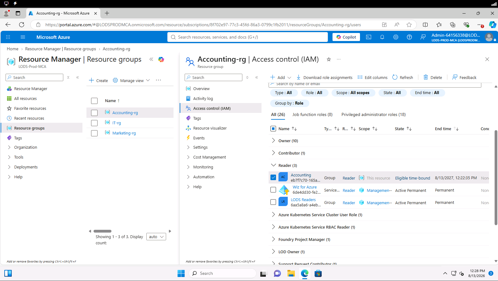
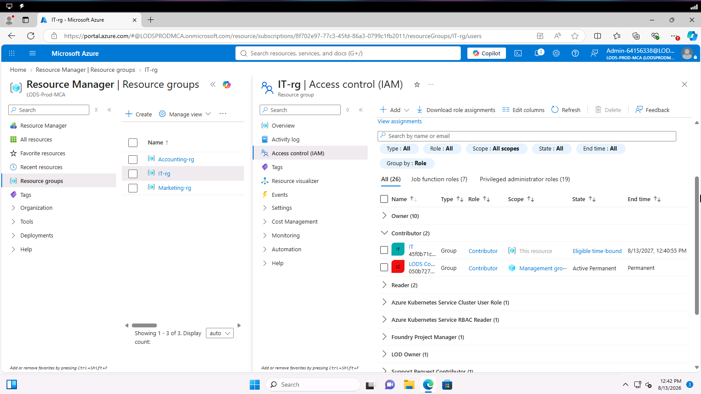
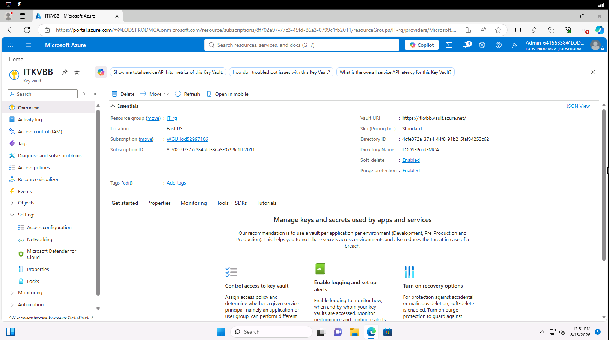
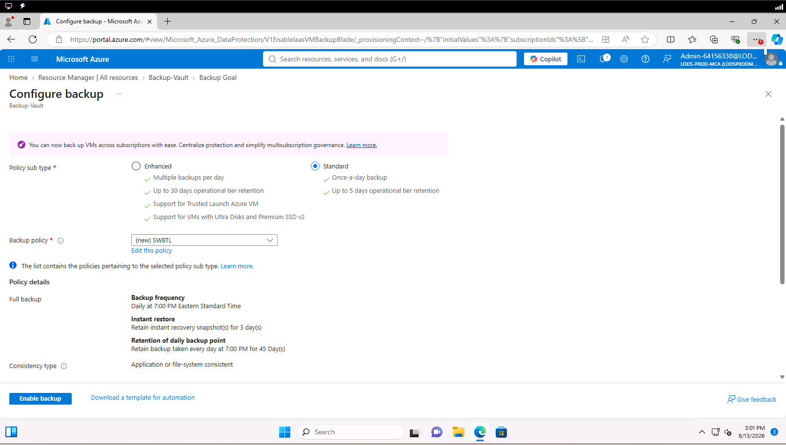
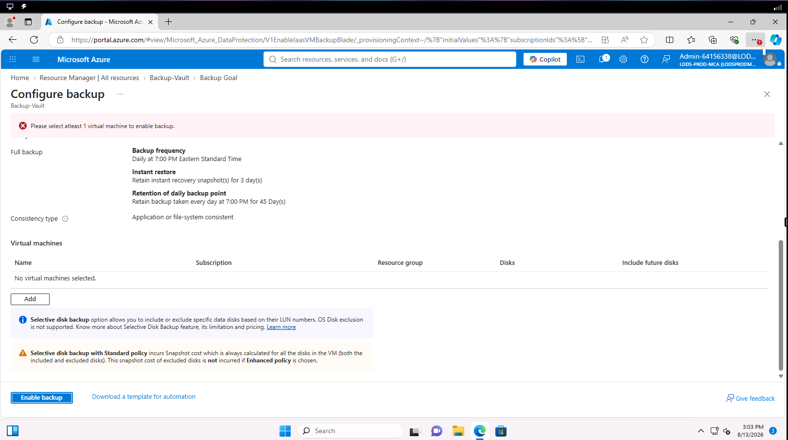

# Azure Cloud Security Lab

## Overview

This project documents a hands-on Microsoft Azure security lab focused on identity and access management, key management, encryption, and backup configuration.

The lab simulated a fictional organization migrating from on-premises infrastructure to Microsoft Azure using an Infrastructure as a Service (IaaS) model.

The objective was to configure Azure security controls that support least-privilege access, data protection, backup and recovery, and cloud security best practices.

## Technologies & Concepts

- Microsoft Azure
- Azure Role-Based Access Control (RBAC)
- Azure Key Vault
- Azure Backup
- Identity and Access Management (IAM)
- Encryption and Key Management
- Infrastructure as a Service (IaaS)
- Cloud Security Risk Management
- NIST SP 800-53

## Lab Objectives

1. Configure Azure RBAC permissions for different organizational departments.
2. Create departmental Azure Key Vault resources and configure data-protection settings.
3. Configure an Azure backup policy to support organizational recovery requirements.
4. Identify security risks associated with migrating to an IaaS environment.
5. Evaluate cloud security practices and the shared responsibility model.

---

## 1. Azure Role-Based Access Control (RBAC)

### Objective

Configure Azure RBAC to restrict access to cloud resources based on departmental responsibilities and the principle of least privilege.

### Configuration

Using the Microsoft Azure portal, I personally assigned built-in Azure RBAC roles for the Accounting, Marketing, and IT departments.

| Department | Assigned Role | Purpose |
|---|---|---|
| Accounting | Reader | Provides read-only access to Azure resources without modification permissions. |
| Marketing | Reader | Allows users to view departmental resources without modifying configurations. |
| IT | Contributor | Allows management of Azure resources without granting permission to assign Azure RBAC roles. |

### Implementation

- **Accounting:** Assigned the Reader role to provide resource visibility while restricting modification permissions.
- **Marketing:** Assigned the Reader role to allow users to view departmental resources without modifying configurations.
- **IT:** Assigned the Contributor role to support Azure resource management and backup administration.

These role assignments were selected to support least privilege by restricting access according to operational responsibilities.

### Configuration Evidence

**Accounting — Reader Role Assignment**

**IT — Contributor Role Assignment**

### Security Benefits

- Limits unnecessary access to Azure resources.
- Reduces unauthorized configuration changes.
- Supports the principle of least privilege.
- Helps reduce the potential impact of compromised user accounts.

---

## 2. Azure Key Vault Configuration

### Objective

Create and configure departmental Azure Key Vault resources to support secure key management and improve data protection within the cloud environment.

### Implementation

Using the Microsoft Azure portal, I personally created Key Vault resources for the following departments:

- Accounting
- Marketing
- IT

I also configured Key Vault deletion-protection settings, including soft delete or purge protection, to help protect resources from accidental or unauthorized deletion.

### Security Controls

**Soft Delete**

Soft delete allows deleted Key Vaults and supported objects to remain recoverable for a configured retention period.

This provides an opportunity to restore resources following accidental or malicious deletion.

**Purge Protection**

Purge protection prevents deleted Key Vaults and protected objects from being permanently removed before their retention period expires.

This helps reduce the risk of irreversible loss of keys and secrets.

### Additional Security Recommendations

The lab also included an evaluation of additional encryption and key management practices.

**Customer-Managed Keys (CMKs)**

Customer-managed keys stored in Azure Key Vault can provide organizations with greater control over encryption key management for supported Azure resources.

**TLS Certificate Management**

Azure Key Vault can support the management of certificates used by applications and services to secure data in transit using TLS.

*These were recommendations rather than configurations validated as implemented in the lab.*

### Configuration Evidence

The following screenshot demonstrates the IT department's
Azure Key Vault with soft delete and purge protection enabled.

## 3. Azure Backup Configuration

### Objective

Configure an Azure backup policy to support organizational recovery requirements and reduce the potential impact of data loss.

### Implementation

Using the Microsoft Azure portal, I personally configured a backup policy with the following settings:

| Configuration | Value |
|---|---|
| Backup Frequency | Daily |
| Scheduled Backup Time | 7:00 PM Eastern |
| Instant Recovery Snapshot Retention | 3 days |
| Daily Backup Retention | 45 days |
| Recovery Point Objective (RPO) | 1 day |
| Recovery Time Objective (RTO) | 36 hours |

The policy was configured to align with the fictional organization's stated recovery requirements.

### Lab Limitations

The lab environment did not populate the expected virtual machines and did not allow new virtual machines to be created.

As a result, the intended Accounting, Marketing, and IT virtual machines could not be associated with the backup policy.

Although the policy settings were configured, successful backup execution and recovery were not validated.

### Configuration Evidence

**Backup Policy Settings**

**Lab Limitation — No Available Virtual Machines**

## 4. Cloud Security Risks

As part of the lab, I evaluated several security risks associated with migrating infrastructure to Microsoft Azure.

### Cloud Misconfiguration

Incorrect identity permissions, storage settings, or network configurations can expose cloud resources to unauthorized access and potential data breaches.

**Recommended Mitigations:**
- Apply least-privilege access.
- Review resource configurations and permissions.
- Monitor cloud environments for configuration changes.

### Unauthorized Access

Weak authentication, compromised credentials, and excessive permissions can increase the likelihood of unauthorized access to cloud resources.

**Recommended Mitigations:**
- Implement multifactor authentication.
- Restrict access using Azure RBAC.
- Monitor authentication activity and privileged access.

### Limited Visibility

Insufficient monitoring can make it difficult to identify suspicious activity or security incidents within cloud environments.

**Recommended Mitigations:**
- Implement continuous security monitoring.
- Review cloud activity and security logs.
- Establish procedures for investigating suspicious events.

---

## 5. Shared Responsibility Model

Microsoft Azure operates under a shared responsibility model in which security responsibilities vary depending on the cloud service model.

Under an IaaS model, the cloud provider secures the underlying physical infrastructure, while the customer retains significant responsibility for the security and configuration of deployed resources.

### Customer Responsibilities

- Identity and access management.
- Operating system and application security.
- Data protection and access controls.
- Network security configurations.
- Backup and recovery planning.

### Cloud Provider Responsibilities

- Physical data center security.
- Physical infrastructure and hardware.
- Underlying host infrastructure.
- Hypervisor infrastructure.

Understanding these responsibilities helps organizations identify which security controls they must configure and maintain when operating in an IaaS environment.

---

## 6. Key Takeaways

This lab provided hands-on experience with:

- Assigning Azure RBAC roles according to departmental responsibilities.
- Creating Azure Key Vault resources and working with deletion-protection settings.
- Configuring an Azure backup policy based on defined recovery requirements.
- Evaluating cloud security risks and recommended mitigations.
- Understanding security responsibilities within an IaaS environment.

## Project Context

This project documents configurations completed in an educational Microsoft Azure lab environment using a fictional organization.

It is not a production deployment. Some configurations, including VM backup execution and restoration, could not be fully validated due to lab environment limitations.
